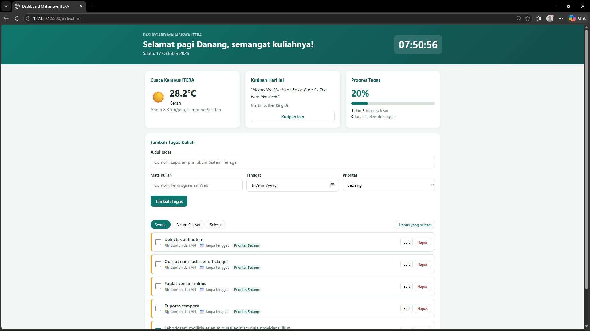
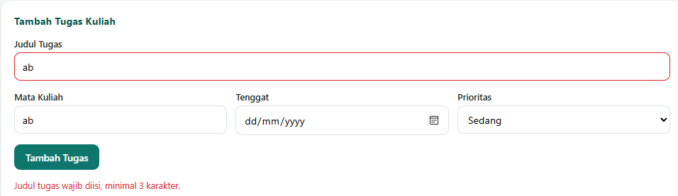

# Dashboard Mahasiswa ITERA

Tugas Praktikum Pemrograman Aplikasi Web (PAW) Pertemuan 2: JavaScript Next Gen (ECMAScript 2015 dan versi setelahnya, disingkat ES6+).

## Identitas

| | |
|---|---|
| **Nama Lengkap** | Danang Ridho Laksono |
| **Nomor Induk Mahasiswa (NIM)** | 123140005 |
| **Kelas Praktikum** | RB |

## Fungsi Aplikasi

Dashboard Mahasiswa ITERA adalah halaman pribadi untuk membantu mahasiswa mengatur tugas kuliah sehari-hari. Dalam satu layar, pengguna bisa melihat sapaan dan jam, cuaca di kampus Institut Teknologi Sumatera (ITERA), kutipan motivasi, progres tugas, dan daftar tugas yang bisa dikelola sendiri.

### Fitur

1. **Manajer tugas kuliah**: tambah, edit, hapus, dan tandai selesai. Setiap tugas punya judul, mata kuliah, tenggat, dan prioritas (rendah, sedang, tinggi).
2. **Validasi form**: judul tugas wajib diisi minimal 3 karakter, pesan error tampil berwarna merah.
3. **Filter daftar**: Semua, Belum Selesai, dan Selesai. Tersedia juga tombol untuk menghapus semua tugas yang sudah selesai.
4. **Penanda terlambat**: tugas yang melewati tenggat dan belum selesai diberi label Terlambat.
5. **Progres tugas**: persentase tugas selesai dengan progress bar, serta jumlah tugas yang melewati tenggat.
6. **Cuaca real-time ITERA** dari Open-Meteo (Application Programming Interface atau API publik).
7. **Kutipan harian** dari DummyJSON, dengan tombol untuk mengambil kutipan lain.
8. **Daftar awal otomatis**: saat pertama kali dibuka dan localStorage masih kosong, 5 tugas contoh diambil dari JSONPlaceholder.
9. **Penyimpanan lokal**: semua tugas disimpan di `localStorage` sehingga tidak hilang saat halaman di-refresh.
10. **Tampilan responsif** untuk layar komputer dan ponsel.

## Tangkapan Layar

> Simpan screenshot kamu di folder `screenshot/` lalu sesuaikan nama file di bawah ini.

**Tampilan utama dashboard**



**Tampilan saat mengedit atau validasi error**



## Daftar Fitur ES6+ yang Diimplementasikan

Seluruh kode ada di file `script.js`.

| Fitur ES6+ | Lokasi (baris) | Keterangan |
|---|---|---|
| `const` untuk nilai tetap | 8, 11, 42, 44, 49, 64 | Konstanta kunci penyimpanan, alamat API, dan fungsi bantu tidak diubah ulang |
| `let` untuk nilai yang berubah | 350 | `sapaan` berubah mengikuti jam (pagi, siang, sore, malam) |
| Arrow functions (lebih dari 3) | 42, 44, 49, 51, 56, 64, 347, 371 | Contoh: `$`, `escapeHtml`, `generateId`, `formatTanggal`, `describeWeather`, `fetchJSON`, `tick`, dan callback `sort` |
| Template literals | 49, 53, 67, 196, 214, 382, 419 | Untuk membuat HTML dinamis (cuaca, kutipan, kartu tugas, statistik) dan id unik |
| Async/await | 64, 142, 191, 210, 223 | `await` dipakai pada pemanggilan `fetchJSON` di baris 147, 194, 213, 230 |
| `Promise.all` | 147 | Cuaca, kutipan, dan data awal dimuat bersamaan |
| Classes | 73 (`TaskItem`), 115 (`DashboardApp`) | `TaskItem` memodelkan satu tugas. `DashboardApp` mengelola state, localStorage, dan pemanggilan `fetch()` |
| Getter dan static method | 92 (`isOverdue`), 109 (`fromJSON`) | Status keterlambatan dan pembuatan objek dari data tersimpan |
| Destructuring pada parameter fungsi | 74, 172, 382 | Constructor `TaskItem`, `addTask`, dan `taskTemplate` |
| Destructuring bersarang dan array | 57, 194, 213 | Mengambil `current_weather` dari respons API dan pasangan label dan ikon cuaca |
| Spread operator (data immutable) | 101, 174, 294, 371 | Tambah tugas, ubah tugas, dan salinan array sebelum diurutkan |
| Default parameter | 74 sampai 81 | Nilai bawaan `course`, `priority`, `done`, dan lainnya |
| Nullish coalescing `??` dan optional chaining `?.` | 57, 153, 319, 391 | Nilai cadangan jika data kosong |
| `Object.fromEntries` | 285 | Mengubah data form menjadi objek |
| `localStorage` dengan `JSON.stringify` dan `JSON.parse` | 153, 161 | Menyimpan dan memuat daftar tugas |

## Sumber API Publik

| Data | Endpoint |
|---|---|
| Cuaca ITERA (Open-Meteo) | `https://api.open-meteo.com/v1/forecast?latitude=-5.36&longitude=105.31&current_weather=true` |
| Kutipan acak (DummyJSON) | `https://dummyjson.com/quotes/random` |
| Tugas awal (JSONPlaceholder) | `https://jsonplaceholder.typicode.com/todos?_limit=5` |

Jika salah satu API gagal dimuat, widget terkait menampilkan pesan gagal dan fitur lain tetap berjalan.

## Cara Menjalankan

1. Buka folder `[NAMA]_[NIM]_pertemuan2` di Visual Studio Code.
2. Pasang ekstensi **Live Server** jika belum ada.
3. Klik kanan `index.html`, lalu pilih **Open with Live Server**.
4. Aplikasi terbuka di browser. Perlu koneksi internet agar cuaca, kutipan, dan data awal tampil.

## Struktur Folder

```
[NAMA]_[NIM]_pertemuan2/
├── index.html      # Struktur halaman
├── style.css       # Tampilan
├── script.js       # Logika JavaScript (ES6+)
├── README.md       # Dokumentasi
└── screenshot/     # Tangkapan layar
```
