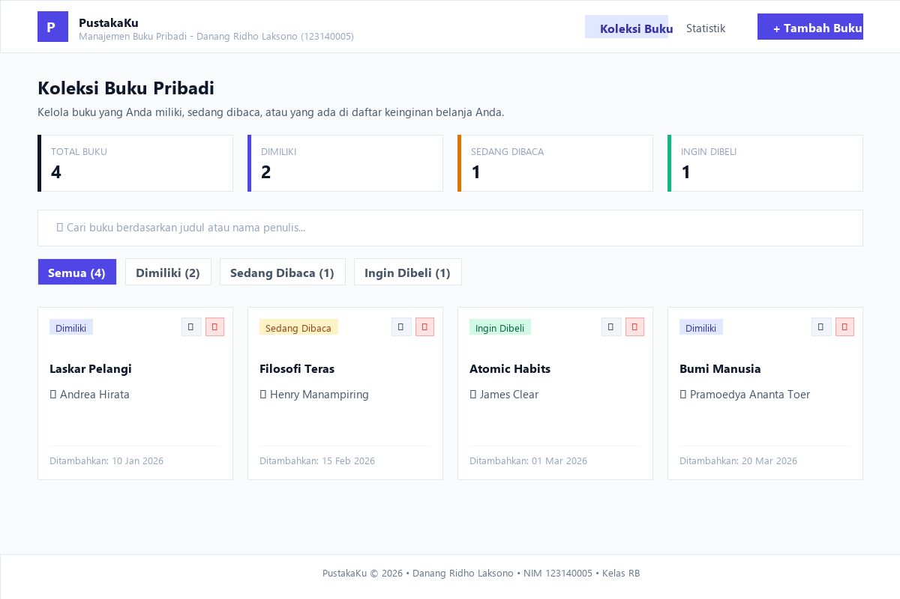
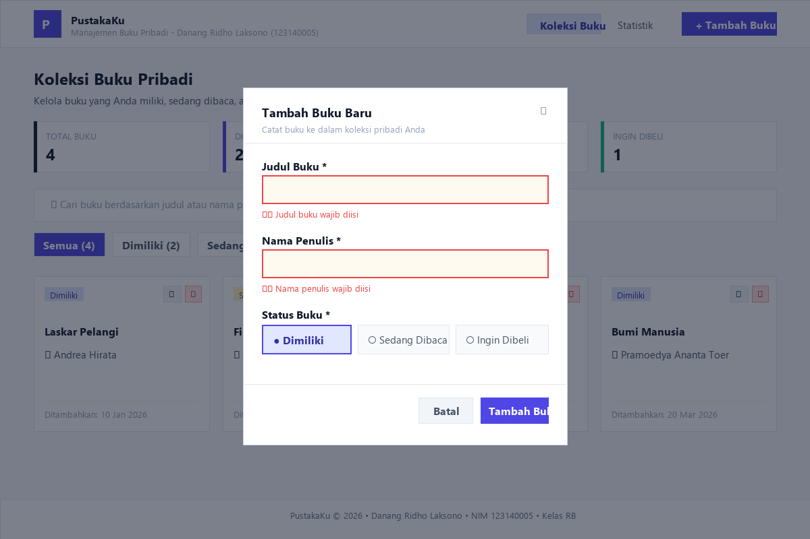
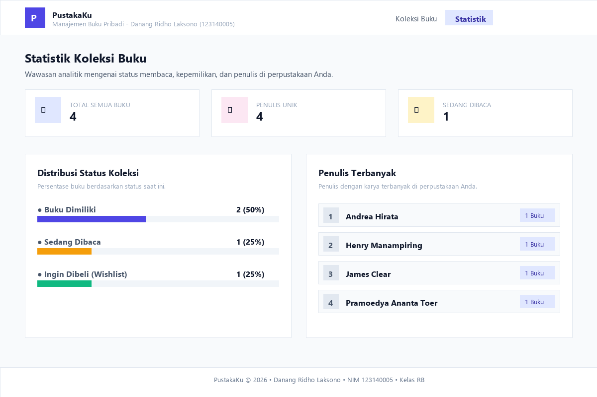
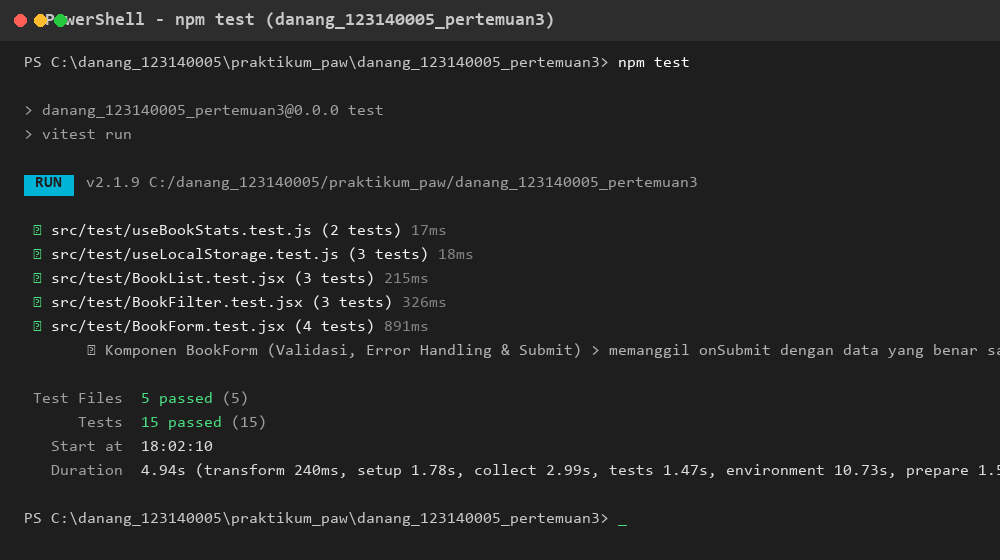

# PustakaKu - Aplikasi Manajemen Buku Pribadi

Tugas Praktikum Pemrograman Aplikasi Web (PAW) Pertemuan 3: React Basics.

---

## Identitas

| | |
|---|---|
| **Nama Lengkap** | Danang Ridho Laksono |
| **Nomor Induk Mahasiswa (NIM)** | 123140005 |
| **Kelas Praktikum** | RB |
| **Teknologi** | React 18, Vite, React Router v6, Vitest & React Testing Library |

---

## Deskripsi Aplikasi

**PustakaKu** adalah aplikasi web manajemen buku pribadi berbasis React yang dirancang untuk memudahkan pengguna dalam mencatat, mengorganisasi, dan memantau status koleksi buku mereka secara terstruktur dan efisien.

Aplikasi ini mengelompokkan buku ke dalam tiga status utama:
1. **Dimiliki (`milik`)**: Buku fisik atau digital yang sudah menjadi koleksi pribadi pengguna.
2. **Sedang Dibaca (`baca`)**: Buku yang saat ini sedang aktif dibaca oleh pengguna.
3. **Ingin Dibeli (`beli`)**: Buku yang masuk ke dalam daftar keinginan (*wishlist*) pengguna untuk dibeli di kemudian hari.

Seluruh data buku disimpan secara persisten di media penyimpanan peramban (`localStorage`), sehingga data tetap aman dan tidak akan hilang meskipun halaman ditutup atau dimuat ulang (*refresh*).

---

## Fitur Utama Aplikasi

1. **Manajemen Data Buku (CRUD Lengkap)**:
   - **Tambah Buku Baru**: Menambahkan judul buku, nama penulis, dan status buku melalui modal form interaktif.
   - **Edit Buku**: Memperbarui informasi buku yang sudah ada dengan formulir yang otomatis terisi data awal.
   - **Hapus Buku**: Menghapus buku dari koleksi dengan dialog konfirmasi aman (*ConfirmDialog*) untuk mencegah penghapusan yang tidak disengaja.
2. **Pencarian Real-Time**:
   - Fitur pencarian buku berdasarkan judul buku atau nama penulis secara instan (*case-insensitive*) dengan tombol reset pencarian (*clear button*).
3. **Penyaringan (Filter) Status Buku**:
   - Tab filter dinamis untuk menyaring daftar buku berdasarkan status: Semua, Dimiliki, Sedang Dibaca, dan Ingin Dibeli, lengkap dengan jumlah counter pada masing-masing kategori.
4. **Validasi Form & Feedback Visual**:
   - Validasi kolom wajib diisi (*mandatory fields*) untuk judul dan nama penulis buku (minimal 2 karakter).
   - Tampilan kolom input berubah merah (*error outline*) dan menampilkan pesan peringatan jika input kosong saat disubmit.
   - Notifikasi *Toast* yang muncul otomatis saat operasi tambah, edit, atau hapus buku berhasil dilakukan.
5. **Halaman Statistik & Analitik Koleksi (`/stats`)**:
   - KPI ringkasan: Total buku, jumlah penulis unik, dan buku yang sedang dibaca.
   - Grafik batang persentase (*distribution bar*) proporsi buku dimiliki, sedang dibaca, dan wishlist.
   - Pemeringkatan penulis dengan karya terbanyak (*Top Authors*).
6. **Navigasi Multi-Halaman Menggunakan React Router**:
   - Navigasi mulus (*Single Page Application*) antara halaman Koleksi Buku (`/`) dan Statistik (`/stats`) tanpa memuat ulang halaman (*page reload*).

---

## Tangkapan Layar Antarmuka

### 1. Tampilan Utama Koleksi Buku
Halaman utama menampilkan ringkasan metrik cepat, kotak pencarian, tombol filter status buku, serta daftar kartu buku responsif.



---

### 2. Form Tambah / Edit Buku dengan Validasi Error
Modal dialog form interaktif yang menampilkan feedback visual dan pesan error saat pengguna mencoba menyimpan form dengan kolom kosong atau tidak valid.



---

### 3. Halaman Statistik & Analitik (`/stats`)
Halaman analitik yang menampilkan persentase distribusi buku berdasarkan status serta daftar peringkat penulis terbanyak.



---

### 4. Laporan Eksekusi Unit Test di Terminal
Hasil eksekusi 5 berkas pengujian unit (15 *test cases*) menggunakan **Vitest** dan **React Testing Library** yang berhasil lolos 100%.



---

## Penerapan Konsep & Fitur React

Aplikasi ini dibangun menggunakan arsitektur modern berbasis React Hooks dan komponen fungsional (*functional components*):

### 1. State Management (`useState`)
- Mengelola state lokal seperti data formulir (`formData`), status validasi form (`errors`, `touched`), status modal pop-up (`isOpen`), pencarian teks (`searchQuery`), dan status filter aktif (`filterStatus`).

### 2. Side Effects (`useEffect`)
- **Sinkronisasi LocalStorage**: Menyimpan data koleksi buku ke penyimpanan peramban secara otomatis setiap kali ada perubahan pada state buku.
- **Sinkronisasi Edit Form**: Mengisi data awal ke input formulir saat pengguna membuka modal untuk mengedit buku.

### 3. Context API (`BookContext.jsx`)
- Menyediakan *single source of truth* untuk state global aplikasi, mencakup:
  - Koleksi buku (`books`)
  - Filter dan pencarian terpadu (`filteredBooks`, `filterStatus`, `searchQuery`)
  - Aksi CRUD (`addBook`, `updateBook`, `deleteBook`)
  - Kontrol modal (`openAddModal`, `openEditModal`, `closeFormModal`)
- Menghindari terjadinya *prop drilling* ke komponen-komponen anak.

### 4. Custom Hooks Minimal 2
1. **`useLocalStorage.js`**:
   - Mengenkapsulasi logika pembacaan awal dari `localStorage` dengan penanganan galat (*error handling* / `try-catch`), serta menyinkronkan pembaruan data secara reaktif menggunakan `useEffect`.
2. **`useBookStats.js`**:
   - Mengkalkulasi data analitik buku secara efisien dengan `useMemo`, menghitung total buku, jumlah dan persentase tiap status, jumlah penulis unik, serta mengelompokkan penulis teratas (*top authors*).

### 5. Komponen Reusable (Dapat Digunakan Kembali)
Aplikasi memisahkan antarmuka menjadi komponen modular mandiri:
- **`BookForm`**: Komponen formulir modal reusable yang dapat digunakan baik untuk menambah buku baru maupun menyunting buku yang sudah ada.
- **`BookList`**: Komponen daftar kartu buku yang menampilkan grid kartu buku atau tampilan kosong (*empty state*) jika tidak ada data yang cocok.
- **`BookFilter`**: Komponen baris pencarian dan tab filter status dengan badge penghitung jumlah buku.
- **`Navbar`**: Komponen bilah navigasi atas dengan logo, status tautan aktif (`NavLink`), dan tombol aksi cepat.
- **`ConfirmDialog`**: Komponen dialog konfirmasi penghapusan reusable untuk meningkatkan keamanan data pengguna.

### 6. Type Checking dengan PropTypes
Seluruh komponen (`BookForm`, `BookList`, `BookFilter`, `Navbar`, `ConfirmDialog`, dan `BookProvider`) menerapkan validasi tipe properti yang ketat menggunakan pustaka `prop-types` guna mencegah kesalahan transmisi tipe data antar komponen.

### 7. Navigasi Multi-Halaman (`react-router-dom`)
- Menggunakan `BrowserRouter`, `Routes`, `Route`, `NavLink`, dan `Link` untuk menyediakan navigasi SPA yang responsif antara rute `/` dan `/stats`.

---

## Struktur Folder Project

```
danang_123140005_pertemuan3/
├── index.html
├── package.json
├── vite.config.js
├── README.md
├── screenshot/
│   ├── tampilan-utama.png
│   ├── form-tambah-validasi.png
│   ├── halaman-statistik.png
│   └── terminal-unit-test.png
└── src/
    ├── main.jsx
    ├── App.jsx
    ├── index.css
    ├── context/
    │   └── BookContext.jsx
    ├── hooks/
    │   ├── useLocalStorage.js
    │   └── useBookStats.js
    ├── components/
    │   ├── Navbar/
    │   │   ├── Navbar.jsx
    │   │   └── Navbar.css
    │   ├── BookForm/
    │   │   ├── BookForm.jsx
    │   │   └── BookForm.css
    │   ├── BookList/
    │   │   ├── BookList.jsx
    │   │   └── BookList.css
    │   ├── BookFilter/
    │   │   ├── BookFilter.jsx
    │   │   └── BookFilter.css
    │   └── ConfirmDialog/
    │       ├── ConfirmDialog.jsx
    │       └── ConfirmDialog.css
    ├── pages/
    │   ├── Home/
    │   │   ├── Home.jsx
    │   │   └── Home.css
    │   └── Stats/
    │       ├── Stats.jsx
    │       └── Stats.css
    └── test/
        ├── setup.js
        ├── useLocalStorage.test.js
        ├── useBookStats.test.js
        ├── BookFilter.test.jsx
        ├── BookList.test.jsx
        └── BookForm.test.jsx
```

---

## Petunjuk Instalasi dan Menjalankan Aplikasi

Pastikan Anda telah memasang **Node.js** (versi 18 ke atas) di perangkat Anda.

### 1. Masuk ke Direktori Project
```bash
cd danang_123140005_pertemuan3
```

### 2. Pasang Dependensi
```bash
npm install
```

### 3. Menjalankan Aplikasi di Server Pengembangan (Development Mode)
```bash
npm run dev
```
Setelah server berjalan, buka peramban dan akses alamat yang tertera (biasanya `http://localhost:5173`).

### 4. Menjalankan Pengujian Unit (Unit Testing)
Untuk mengeksekusi seluruh rangkaian pengujian unit:
```bash
npm test
```
Atau jika ingin menjalankan pengujian dengan pemantauan otomatis (*watch mode*):
```bash
npm run test:watch
```

### 5. Membangun Aplikasi untuk Produksi (Production Build)
```bash
npm run build
```
Hasil kompilasi siap produksi akan tersimpan di dalam folder `dist/`. Untuk meninjaunya:
```bash
npm run preview
```

---
