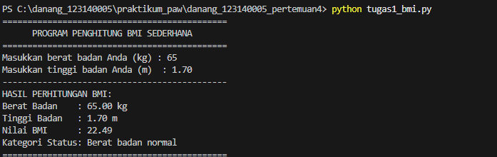
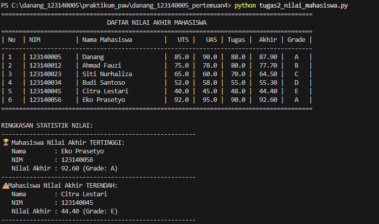
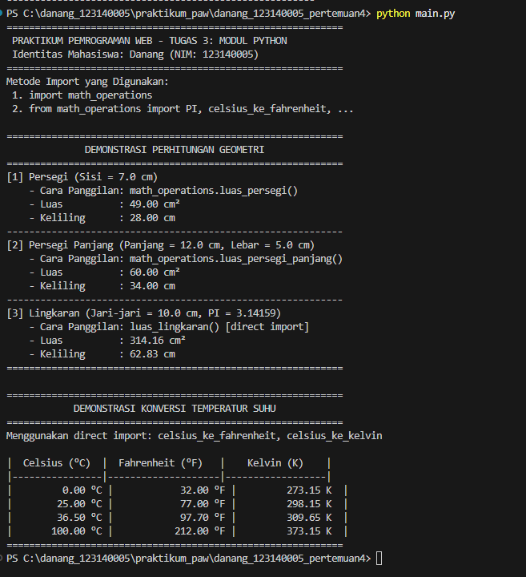

# Laporan Praktikum Pemrograman Web - Pertemuan 4
## Dasar Pemrograman Python

### Identitas Mahasiswa
* **Nama** : Danang
* **NIM**  : 123140005
* **Kelas** : Praktikum Pemrograman Web (PAW)

---

## 📁 Struktur Direktori

```text
danang_123140005_pertemuan4/
├── .gitignore
├── README.md
├── tugas1_bmi.py
├── tugas2_nilai_mahasiswa.py
├── math_operations.py
├── main.py
└── screenshots/
    ├── tugas1_bmi.png
    ├── tugas2_nilai_mahasiswa.png
    └── tugas3_main.png
```

---

## 📌 Ringkasan Tugas & Penjelasan Program

### 1. Soal 1: Program Penghitung BMI (`tugas1_bmi.py`)
* **Bobot**: 30%
* **Deskripsi**:
  Program untuk menghitung indeks massa tubuh (*Body Mass Index* / BMI) berdasarkan berat badan (kg) dan tinggi badan (m) pengguna.
* **Alur Kerja**:
  1. Menerima input berat badan (kg) dan tinggi badan (m) dari pengguna melalui `input()`.
  2. Memvalidasi input agar bernilai numerik positif (> 0).
  3. Menghitung nilai BMI dengan rumus:
     $$\text{BMI} = \frac{\text{berat}}{\text{tinggi}^2}$$
  4. Mengklasifikasikan hasil menggunakan struktur kontrol percabangan `if-elif-else`:
     * $\text{BMI} < 18.5$: Berat badan kurang
     * $18.5 \le \text{BMI} < 25$: Berat badan normal
     * $25 \le \text{BMI} < 30$: Berat badan berlebih
     * $\text{BMI} \ge 30$: Obesitas
  5. Menampilkan nilai BMI (diformat dengan 2 angka di belakang desimal menggunakan *f-string*) beserta kategori status berat badan ke konsol.

---

### 2. Soal 2: Program Pengelolaan Data Nilai Mahasiswa (`tugas2_nilai_mahasiswa.py`)
* **Bobot**: 40%
* **Deskripsi**:
  Program untuk mengelola data nilai mahasiswa menggunakan struktur data koleksi `list` of `dictionary`.
* **Alur Kerja**:
  1. Menyimpan data minimal 5 mahasiswa (di program ini terdapat 6 mahasiswa) dalam bentuk list of dictionary dengan atribut: `nama`, `nim`, `nilai_uts`, `nilai_uas`, dan `nilai_tugas`.
  2. Menghitung nilai akhir dengan formula:
     $$\text{Nilai Akhir} = (30\% \times \text{UTS}) + (40\% \times \text{UAS}) + (30\% \times \text{Tugas})$$
  3. Mengonversi nilai akhir menjadi grade huruf:
     * **A**: $\ge 80$
     * **B**: $70 \le \text{Nilai} < 80$
     * **C**: $60 \le \text{Nilai} < 70$
     * **D**: $50 \le \text{Nilai} < 60$
     * **E**: $< 50$
  4. Menampilkan data seluruh mahasiswa dalam tabel terformat rapi menggunakan *f-string*.
  5. Mencari dan menampilkan informasi mahasiswa dengan nilai akhir tertinggi dan terendah menggunakan fungsi bawaan `max()` dan `min()`.

---

### 3. Soal 3: Modul Matematika & Program Penggunaannya (`math_operations.py` & `main.py`)
* **Bobot**: 30%
* **Deskripsi**:
  Pembuatan modul kustom Python dan pemanggilannya pada program utama dengan menerapkan teknik modularitas fungsi dan variasi metode import.

#### A. Berkas `math_operations.py` (Modul)
Menyediakan konstanta matematika dan fungsi-fungsi perhitungan:
* **Konstanta**: `PI = 3.14159`
* **Geometri Bangun Datar**:
  * `luas_persegi(sisi)` & `keliling_persegi(sisi)`
  * `luas_persegi_panjang(panjang, lebar)` & `keliling_persegi_panjang(panjang, lebar)`
  * `luas_lingkaran(jari_jari)` & `keliling_lingkaran(jari_jari)`
* **Konversi Suhu**:
  * `celsius_ke_fahrenheit(celsius)`: $(C \times \frac{9}{5}) + 32$
  * `celsius_ke_kelvin(celsius)`: $C + 273.15$

#### B. Berkas `main.py` (Program Utama)
* Mengimplementasikan 2 cara import yang berbeda:
  1. `import math_operations` (mengakses fungsi modul secara utuh)
  2. `from math_operations import PI, celsius_ke_fahrenheit, celsius_ke_kelvin, ...` (mengimpor fungsi dan konstanta langsung ke *current namespace*)
* Menjalankan seluruh fungsi dengan variasi input pengujian.
* Menampilkan output perhitungan secara rapi dan terstruktur dalam bentuk ringkasan dan tabel.

---

## 🚀 Panduan Menjalankan Program di Terminal

Pastikan Python 3 sudah terpasang di sistem operasi Anda. Buka terminal atau PowerShell, arahkan ke folder repositori `danang_123140005_pertemuan4`:

```bash
cd danang_123140005_pertemuan4
```

### 1. Menjalankan Soal 1 (Penghitung BMI)
```bash
python tugas1_bmi.py
```
*Masukkan nilai berat badan (kg) dan tinggi badan (m) ketika diminta oleh program.*

### 2. Menjalankan Soal 2 (Pengelolaan Nilai Mahasiswa)
```bash
python tugas2_nilai_mahasiswa.py
```

### 3. Menjalankan Soal 3 (Program Utama Modul Matematika)
```bash
python main.py
```

---

## 📷 Bukti Eksekusi Terminal

### 1. Bukti Eksekusi Soal 1 (`tugas1_bmi.py`)



---

### 2. Bukti Eksekusi Soal 2 (`tugas2_nilai_mahasiswa.py`)



---

### 3. Bukti Eksekusi Soal 3 (`main.py`)



---

## 📋 Kepatuhan Standar Penulisan & Best Practices
1. **PEP 8 Compliant**:
   - Indentasi konsisten 4 spasi (tanpa tab).
   - Penamaan berkas, variabel, dan fungsi menggunakan konvensi `snake_case`.
   - Penamaan konstanta menggunakan `UPPER_SNAKE_CASE` (misal: `PI`).
2. **Dokumentasi & Type Hinting**:
   - Seluruh fungsi dilengkapi dengan *docstring* penjelasan tujuan fungsi, deskripsi parameter input, dan nilai return.
   - Menggunakan *type hints* standar Python untuk kejelasan tipe data.
