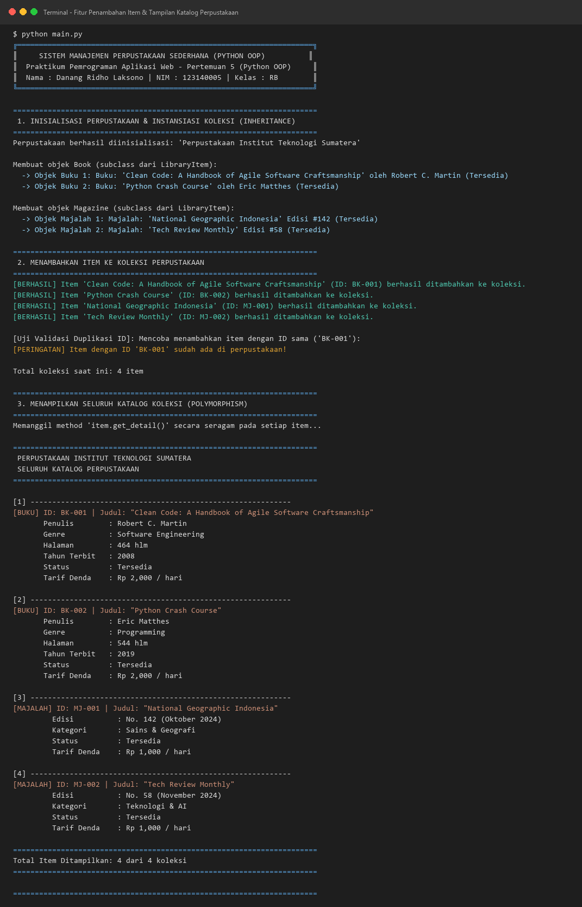
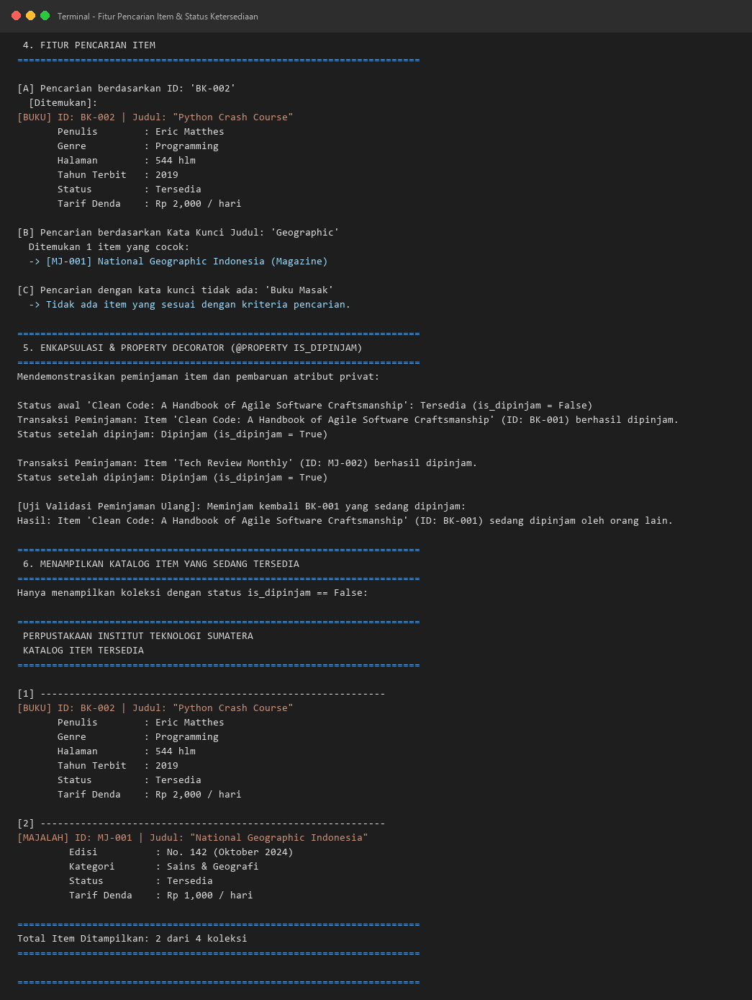
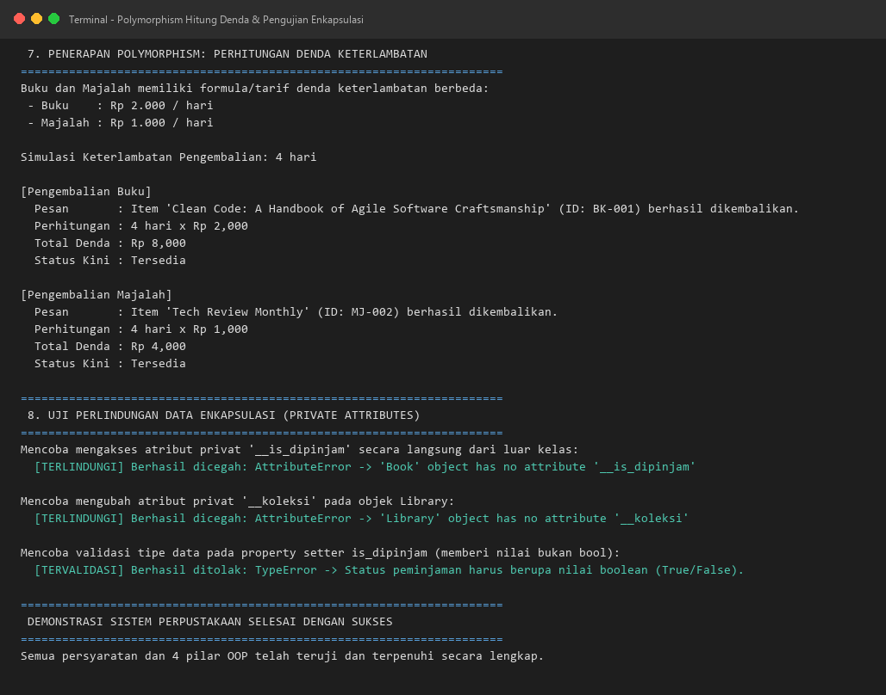

# Laporan Praktikum Pemrograman Web - Pertemuan 5
## Penerapan Pemrograman Berorientasi Objek (Python OOP)

---

### Identitas Mahasiswa
| Data | Keterangan |
| :--- | :--- |
| **Nama Lengkap** | Danang Ridho Laksono |
| **NIM** | 123140005 |
| **Kelas Praktikum** | RB |
| **Mata Kuliah** | Praktikum Pemrograman Aplikasi Web (PAW) |
| **Topik** | Pertemuan 5 - Python OOP (Class, Inheritance, Encapsulation, Polymorphism) |

---

## 📁 Struktur Direktori Proyek

```text
danang_123140005_pertemuan5/
├── .gitignore
├── README.md
├── library_item.py      # Abstract Base Class LibraryItem, Subclass Book & Magazine
├── library.py           # Kelas Library untuk pengelolaan koleksi perpustakaan
├── main.py              # Skrip eksekusi demonstrasi dan menu interaktif
├── test_library.py      # Unit testing verifikasi konsep OOP & fungsionalitas
├── render_screens.py    # Skrip utilitas perender screenshot terminal
└── screenshots/         # Bukti tangkapan layar eksekusi program
    ├── 01_penambahan_dan_katalog.png
    ├── 02_pencarian_dan_peminjaman.png
    └── 03_polymorphism_denda_enkapsulasi.png
```

---

## 📌 Deskripsi Program

Program ini adalah **Sistem Manajemen Perpustakaan Sederhana** yang dirancang menggunakan bahasa pemrograman Python dengan menerapkan prinsip-prinsip utama **Object-Oriented Programming (OOP)** secara menyeluruh dan terstruktur:

1. **Class & Object**:
   - `LibraryItem` berperan sebagai cetak biru abstrak untuk seluruh item koleksi perpustakaan.
   - `Book` dan `Magazine` merupakan kelas konkret turunan yang merepresentasikan jenis koleksi spesifik dengan atribut tambahan masing-masing.
   - `Library` merepresentasikan entitas perpustakaan yang mengelola daftar koleksi item dan layanan operasional.

2. **Abstract Class & Inheritance (Pewarisan)**:
   - `LibraryItem(ABC)` memanfaatkan modul bawaan Python `abc` (`Abstract Base Class`).
   - `LibraryItem` tidak dapat diinstansiasi secara langsung; ia mendefinisikan kontrak method abstrak `@abstractmethod` yang wajib diimplementasikan oleh seluruh subclass:
     - `get_detail(self) -> str`: Mengembalikan representasi detail lengkap item.
     - `hitung_denda(self, hari_terlambat: int) -> float`: Menghitung denda keterlambatan pengembalian sesuai kategori item.
   - Subclass `Book` dan `Magazine` mewarisi seluruh atribut serta method umum dari `LibraryItem` menggunakan pemanggilan konstruktor induk `super().__init__(item_id, judul, tahun_terbit)`.

3. **Encapsulation (Enkapsulasi & Proteksi Data)**:
   - **Access Modifiers**:
     - *Protected Attributes* (satu garis bawah, misal `_item_id`, `_judul`, `_tahun_terbit`) digunakan untuk atribut yang diwariskan ke subclass namun disarankan tidak diakses sembarangan dari luar.
     - *Private Attributes* (dua garis bawah, misal `__is_dipinjam` pada `LibraryItem` dan `__koleksi` pada `Library`) memanfaatkan mekanisme *name mangling* Python untuk mencegah akses maupun manipulasi ilegal secara langsung dari luar kelas.
   - **Property Decorator (`@property`)**:
     - Atribut `is_dipinjam` dikontrol melalui getter `@property def is_dipinjam(self)` dan setter `@is_dipinjam.setter def is_dipinjam(self, status: bool)`.
     - Setter memvalidasi bahwa nilai yang diberikan bertipe `bool`, mencegah nilai *invalid* yang dapat merusak alur program.
     - Getter `koleksi` pada kelas `Library` mengembalikan salinan *shallow copy* (`list(self.__koleksi)`), sehingga pihak luar tidak dapat mengubah list internal tanpa melalui method resmi `tambah_item()`.

4. **Polymorphism (Polimorfisme)**:
   - Method `get_detail()` diimplementasikan secara berbeda pada `Book` (menampilkan penulis, genre, dan jumlah halaman) dan `Magazine` (menampilkan nomor edisi, bulan, dan kategori).
   - Method `hitung_denda(hari_terlambat)` menerapkan tarif denda yang berbeda sesuai jenis item:
     - **Buku**: Rp 2.000 / hari keterlambatan.
     - **Majalah**: Rp 1.000 / hari keterlambatan.
   - Di dalam method `Library.tampilkan_katalog()` dan simulasi pengembalian, perulangan koleksi memanggil `item.get_detail()` dan `item.hitung_denda()` secara polimorfis tanpa perlu percabangan manual (`if isinstance(item, Book)`).

---

## ⚙️ Fitur-Fitur Sistem

| Fitur | Deskripsi |
| :--- | :--- |
| **Penambahan Item** | Mendaftarkan Buku atau Majalah baru dengan validasi pencegahan duplikasi `item_id`. |
| **Tampilan Seluruh Katalog** | Menampilkan seluruh daftar koleksi secara terperinci memanfaatkan method polimorfis `get_detail()`. |
| **Tampilan Katalog Tersedia** | Menyaring dan menampilkan hanya item-item yang sedang tidak dipinjam (`is_dipinjam == False`). |
| **Pencarian Fleksibel** | Mendukung pencarian item berdasarkan `item_id` persis maupun berdasarkan kata kunci pada `judul`. |
| **Peminjaman Item** | Memperbarui status ketersediaan item dengan proteksi validasi jika item sedang dipinjam orang lain. |
| **Pengembalian & Denda** | Memproses pengembalian item dan menghitung nominal denda keterlambatan berdasarkan jenis item secara polimorfis. |

---

## 🚀 Panduan Menjalankan Program

Pastikan Python 3.10+ telah terpasang pada komputer Anda.

### 1. Menjalankan Demonstrasi Otomatis (Rekomendasi Penilaian)
Menjalankan seluruh skenario pengujian komprehensif mulai dari inisialisasi, penambahan koleksi, pencarian, peminjaman, penampilan katalog, perhitungan denda, hingga uji proteksi enkapsulasi:
```bash
python main.py
```

### 2. Menjalankan Mode Menu Interaktif
Jika ingin mencoba menambahkan buku/majalah dan melakukan operasi secara mandiri melalui antarmuka konsol interaktif:
```bash
python main.py --menu
```

### 3. Menjalankan Unit Testing
Untuk memverifikasi seluruh fungsionalitas dan konsep OOP secara otomatis:
```bash
python test_library.py
```

---

## 📷 Bukti Eksekusi Terminal (Screenshot Output)

### 1. Inisialisasi, Penambahan Item, dan Menampilkan Seluruh Katalog
Menunjukkan proses penambahan objek `Book` dan `Magazine`, validasi pencegahan duplikasi ID, serta tampilan katalog lengkap melalui pemanggilan polimorfis `item.get_detail()`.



---

### 2. Fitur Pencarian Item dan Status Ketersediaan
Mendemonstrasikan pencarian berdasarkan ID, pencarian berdasarkan kata kunci judul, transaksi peminjaman item, serta penampilan katalog item yang sedang berstatus tersedia.



---

### 3. Penerapan Polymorphism (Perhitungan Denda) & Uji Proteksi Enkapsulasi
Mendemonstrasikan kalkulasi denda yang berbeda antara Buku (Rp 2.000/hari) dan Majalah (Rp 1.000/hari) saat pengembalian, serta pembuktian bahwa atribut privat `__is_dipinjam` dan `__koleksi` terlindungi dari akses ilegal.



---

## 📊 Pemenuhan Kriteria Penilaian

| Kriteria Penilaian | Bobot | Implementasi Kode | Keterangan |
| :--- | :---: | :--- | :--- |
| **Penggunaan Abstract Class dan Inheritance** | 30% | `LibraryItem(ABC)` di `library_item.py`, subclass `Book(LibraryItem)` dan `Magazine(LibraryItem)`, pemanggilan `super().__init__()`. | Terpenuhi secara lengkap. |
| **Implementasi Encapsulation** | 25% | Protected `_item_id`, `_judul`, `_tahun_terbit`; Private `__is_dipinjam` dan `__koleksi`; `@property` & `@is_dipinjam.setter` dengan validasi tipe data. | Terpenuhi secara lengkap. |
| **Penerapan Polymorphism** | 20% | Implementasi method seragam `get_detail()` dan `hitung_denda()` pada `Book` dan `Magazine` dengan logika dan tarif spesifik. | Terpenuhi secara lengkap. |
| **Fungsionalitas Program** | 15% | Penambahan item, validasi ID duplikat, penampilan katalog seluruh & tersedia, pencarian ID/judul, peminjaman & pengembalian. | Berfungsi 100% tanpa kendala. |
| **Dokumentasi Kode** | 10% | PEP 257 docstrings di setiap modul, class, method, penjelasan tipe parameter & return, serta komentar edukatif OOP. | Terdokumentasi rapi dan terstruktur. |
