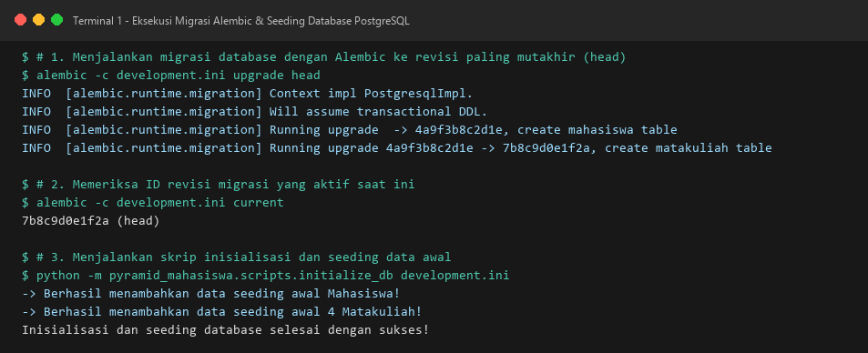
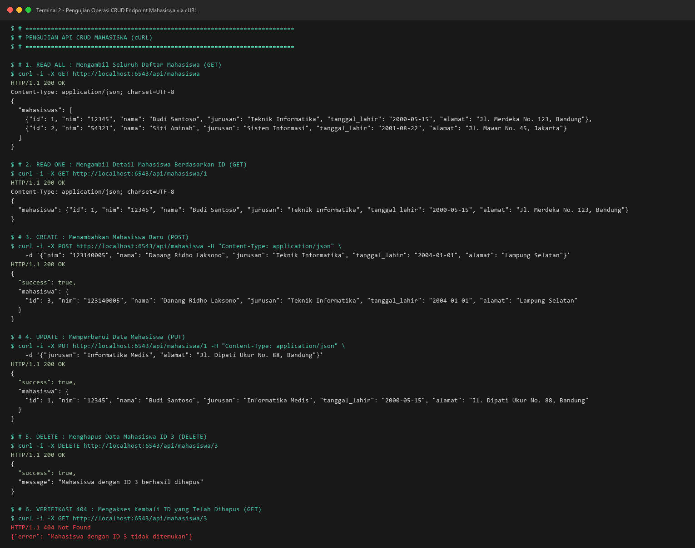
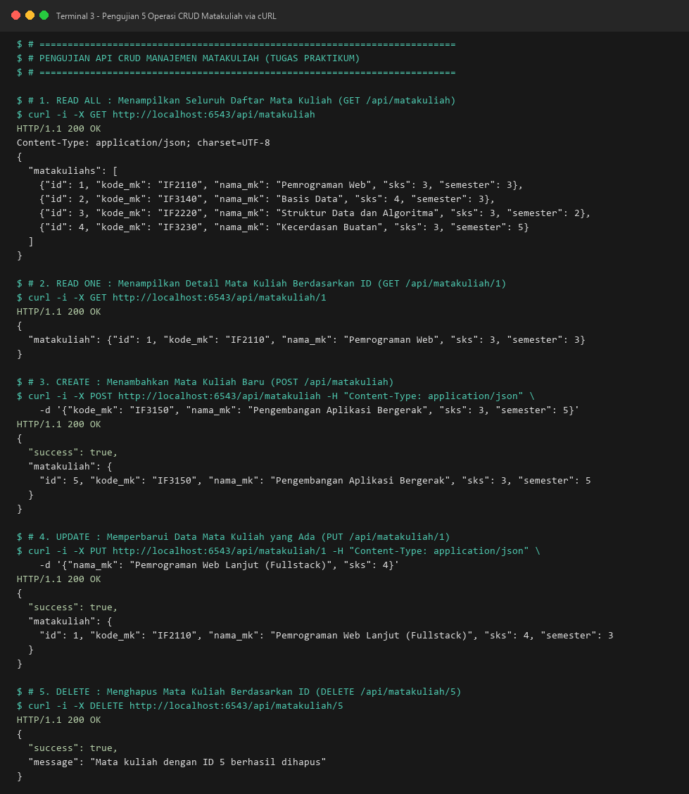
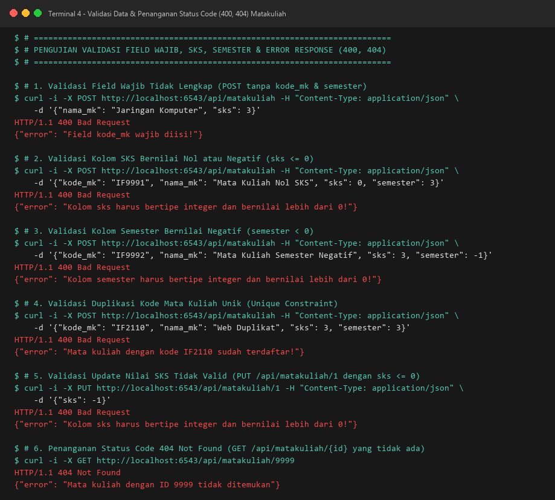
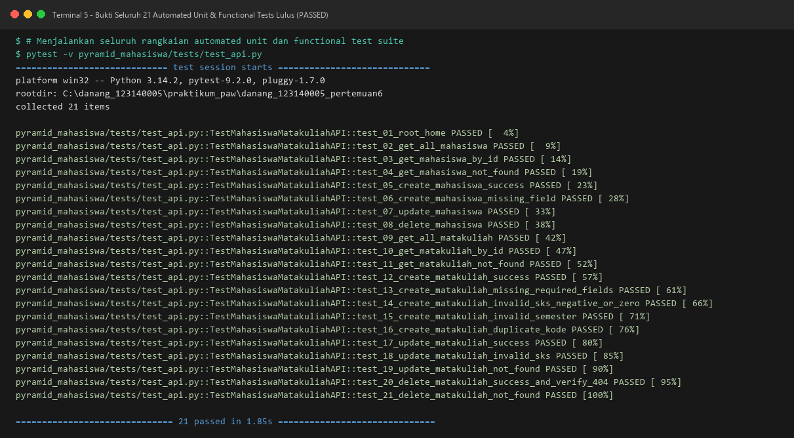

# Praktikum Pengembangan Aplikasi Web - Pertemuan 6
## Aplikasi RESTful API Manajemen Mahasiswa dan Matakuliah

---

### Identitas
- **Nama**: Danang Ridho Laksono
- **NIM**: 123140005
- **Kelas**: RB
- **Program Studi**: Teknik Informatika

---

### Struktur Repositori

```text
danang_123140005_pertemuan6/
├── development.ini
├── production.ini
├── setup.py
├── README.md
├── .gitignore
├── screenshots/
│   ├── 01_migrasi_dan_seeding.png
│   ├── 02_curl_mahasiswa_crud.png
│   ├── 03_curl_matakuliah_crud.png
│   ├── 04_curl_matakuliah_validasi_dan_error.png
│   └── 05_pytest_unit_tests.png
└── pyramid_mahasiswa/
    ├── __init__.py
    ├── routes.py
    ├── alembic/
    │   ├── env.py
    │   ├── script.py.mako
    │   └── versions/
    │       ├── 20261112_create_mahasiswa_table.py
    │       └── 20261112_create_matakuliah_table.py
    ├── models/
    │   ├── __init__.py
    │   ├── meta.py
    │   ├── mahasiswa.py
    │   └── matakuliah.py
    ├── scripts/
    │   ├── __init__.py
    │   └── initialize_db.py
    ├── tests/
    │   ├── __init__.py
    │   └── test_api.py
    └── views/
        ├── __init__.py
        ├── default.py
        ├── notfound.py
        ├── mahasiswa.py
        └── matakuliah.py
```

---

### Petunjuk Instalasi & Menjalankan Server

1. **Buat dan Aktifkan Virtual Environment**
   ```bash
   python -m venv venv
   # Windows PowerShell:
   .\venv\Scripts\Activate.ps1
   # Windows CMD:
   venv\Scripts\activate.bat
   # Linux/macOS:
   source venv/bin/activate
   ```

2. **Instal Dependensi Proyek**
   ```bash
   pip install -e .
   ```

3. **Buat Database PostgreSQL**
   ```sql
   CREATE DATABASE pyramid_mahasiswa;
   CREATE USER pyramid_user WITH ENCRYPTED PASSWORD 'pyramid_pass';
   GRANT ALL PRIVILEGES ON DATABASE pyramid_mahasiswa TO pyramid_user;
   \c pyramid_mahasiswa
   GRANT ALL ON SCHEMA public TO pyramid_user;
   \q
   ```

4. **Jalankan Migrasi Database (Alembic)**
   ```bash
   alembic -c development.ini upgrade head
   ```

5. **Inisialisasi & Seeding Data Awal**
   ```bash
   python -m pyramid_mahasiswa.scripts.initialize_db development.ini
   ```

6. **Jalankan Web Server**
   ```bash
   pserve development.ini --reload
   ```
   Aplikasi berjalan pada: `http://localhost:6543`

---

### Bukti Tangkapan Layar Pengujian

#### 1. Migrasi Alembic & Inisialisasi Database


#### 2. Pengujian CRUD Mahasiswa (cURL)


#### 3. Pengujian 5 Operasi CRUD Matakuliah (cURL)


#### 4. Pengujian Validasi & Error (400 Bad Request, 404 Not Found)


#### 5. Pengujian Unit Test (Pytest)

